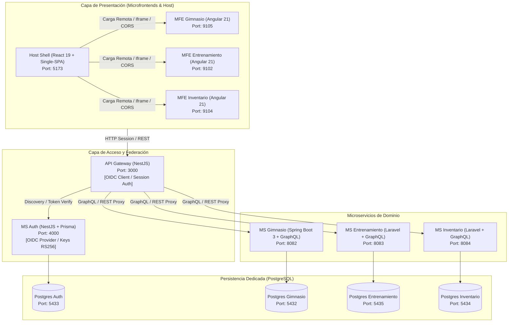

# 🏋️ Apex Fitness - Plataforma Distribuida con SSO / OIDC
> Arquitectura de Microservicios y Microfrontends con Inicio de Sesión Único (Single Sign-On / OpenID Connect)

[](https://nestjs.com/)
[](https://react.dev/)
[](https://angular.dev/)
[](https://spring.io/)
[](https://laravel.com/)
[](https://www.postgresql.org/)
[](https://www.docker.com/)

---

## 📌 Tabla de Contenidos
1. [Descripción General](#-descripción-general)
2. [Arquitectura del Sistema](#-arquitectura-del-sistema)
3. [Mapeo de Módulos y Puertos](#-mapeo-de-módulos-y-puertos)
4. [Despliegue con Docker](#-despliegue-con-docker)
   - [Opción A: Levantar Todo el Ecosistema (Global)](#opción-a-levantar-todo-el-ecosistema-global)
   - [Opción B: Levantar Módulos de Forma Individual](#opción-b-levantar-módulos-de-forma-individual)
5. [Ejecución en Desarrollo Local (Sin Docker)](#-ejecución-en-desarrollo-local-sin-docker)
6. [Flujo de Autenticación SSO / OIDC](#-flujo-de-autenticación-sso--oidc)
7. [Seguridad y Secretos](#-seguridad-y-secretos)
8. [Licencia](#-licencia)

---

## 📖 Descripción General

**Apex Fitness** es un ecosistema de software distribuido de nivel empresarial diseñado para la administración integral de centros de entrenamiento y acondicionamiento físico. 

El sistema implementa:
- **Autenticación Centralizada SSO (Single Sign-On)** basada en el estándar **OpenID Connect (OIDC)** y tokens criptográficos asimétricos (RS256).
- **Backend For Frontend (BFF) / API Gateway** para unificar el punto de entrada, validar sesiones de usuario y distribuir peticiones a los microservicios.
- **Microfrontends Independientes** gobernados por un Host Shell basado en **React 19 + Single-SPA**, montando dinámicamente aplicaciones remotas desarrolladas en **Angular 21**.
- **Microservicios Políglotas** construidos con las tecnologías líderes de la industria: **NestJS / Prisma**, **Spring Boot 3 (Java 21)** y **Laravel 11 (PHP 8.2)**, con persistencia aislada en **PostgreSQL**.

---

## 🏛️ Arquitectura del Sistema



---

## 🗺️ Mapeo de Módulos y Puertos

| Módulo | Tipo | Tecnologías Clave | Puerto App | Puerto BD Host |
| :--- | :--- | :--- | :--- | :--- |
| **`shell`** | Frontend Host | React 19, Single-SPA, Vite, Axios | `5173` | N/A |
| **`mfe-gimnasio`** | Microfrontend | Angular 21, QR Code, HTML5 Scanner | `9105` | N/A |
| **`mfe-entrenamiento`**| Microfrontend | Angular 21, Single-SPA | `9102` | N/A |
| **`mfe-inventario`** | Microfrontend | Angular 21, Single-SPA | `9104` | N/A |
| **`api-gateway`** | BFF / Gateway | NestJS, OpenID-Client, Express-Session | `3000` | N/A |
| **`ms-auth`** | Microservicio Auth | NestJS, Prisma ORM, OIDC Provider, Jose | `4000` | `5433` |
| **`ms-gimnasio`** | Microservicio Dominio| Spring Boot 3, Java 21, Flyway, GraphQL | `8082` | `5432` |
| **`ms-entrenamiento`**| Microservicio Dominio| Laravel 11, PHP 8.2, Lighthouse GraphQL | `8083` | `5435` |
| **`ms-inventario`** | Microservicio Dominio| Laravel 11, PHP 8.2, Lighthouse GraphQL | `8084` | `5434` |
| **`ms-agentes`** | Agente Inteligente (CU-23) | Python 3.12, FastAPI, Hexagonal, IA Local WebGPU | `8085` | `5436` |

---

## 🐳 Despliegue con Docker

Cada módulo cuenta con su propio `Dockerfile` y `docker-compose.yml` para desarrollo aislado, además de un orquestador global en la raíz.

### Opción A: Levantar Todo el Ecosistema (Global)
Para iniciar los 9 módulos y las 4 bases de datos simultáneamente:

```bash
docker compose up -d
```

Para detener todos los servicios:
```bash
docker compose down
```

---

### Opción B: Levantar Módulos de Forma Individual
Si solo deseas trabajar en un microservicio o frontend específico, puedes navegar a su directorio y ejecutar su propio Compose:

#### 1. Microservicio Auth & OIDC:
```bash
cd ms-auth
docker compose up -d
```
*(Inicia la base de datos en el puerto 5433 y la API OIDC en el puerto 4000).*

#### 2. API Gateway:
```bash
cd api-gateway
docker compose up -d
```
*(Inicia el Gateway en el puerto 3000).*

#### 3. Microservicio Gimnasio:
```bash
cd ms-gimnasio
docker compose up -d
```
*(Inicia Postgres en el puerto 5432 y Spring Boot en el puerto 8082).*

#### 4. Microservicio Entrenamiento:
```bash
cd ms-entrenamiento
docker compose up -d
```
*(Inicia Postgres en el puerto 5435 y Laravel en el puerto 8083).*

#### 5. Microservicio Inventario:
```bash
cd ms-inventario
docker compose up -d
```
*(Inicia Postgres en el puerto 5434 y Laravel en el puerto 8084).*

#### 6. Microfrontends y Host:
```bash
# Host Shell
cd shell && docker compose up -d

# MFE Gimnasio
cd mfe-gimnasio && docker compose up -d

# MFE Entrenamiento
cd mfe-entrenamiento && docker compose up -d

# MFE Inventario
cd mfe-inventario && docker compose up -d
```

---

## 💻 Ejecución en Desarrollo Local (Sin Docker)

### Prerrequisitos
- **Node.js**: v20 o v22 LTS
- **Java**: JDK 21 (Temurin o OpenJDK)
- **PHP**: v8.2 o v8.3 con extensiones `pdo_pgsql`, `mbstring`, `zip`, `xml`
- **Composer**: v2.x
- **PostgreSQL**: Instalado localmente o ejecutando contenedores de base de datos.

### Paso 1: Configurar Variables de Entorno
Copia los archivos de ejemplo en cada servicio:
```bash
# API Gateway
cp api-gateway/.env.example api-gateway/.env

# MS Auth
cp ms-auth/.env.example ms-auth/.env

# MS Entrenamiento
cp ms-entrenamiento/.env.example ms-entrenamiento/.env

# MS Inventario
cp ms-inventario/.env.example ms-inventario/.env
```

### Paso 2: Generar Claves Criptográficas OIDC
En `ms-auth`:
```bash
cd ms-auth
npm install
node scripts/generate-oidc-keys.mjs
npx prisma generate
npx prisma migrate dev
npm run start:dev
```

### Paso 3: Iniciar Microservicios de Backend
- **API Gateway**: `cd api-gateway && npm install && npm run start:dev`
- **MS Gimnasio**: `cd ms-gimnasio && ./mvnw spring-boot:run`
- **MS Entrenamiento**: `cd ms-entrenamiento && composer install && php artisan serve --port=8083`
- **MS Inventario**: `cd ms-inventario && composer install && php artisan serve --port=8084`

### Paso 4: Iniciar Microfrontends y Shell
- **Shell (Host)**: `cd shell && npm install && npm run dev` (http://localhost:5173)
- **MFE Gimnasio**: `cd mfe-gimnasio && npm install && npm start` (http://localhost:9105)
- **MFE Entrenamiento**: `cd mfe-entrenamiento && npm install && npm start` (http://localhost:9102)
- **MFE Inventario**: `cd mfe-inventario && npm install && npm start` (http://localhost:9104)

---

## 🔐 Flujo de Autenticación SSO / OIDC

1. El usuario accede al **Shell Host** (`http://localhost:5173`).
2. Al pulsar **Iniciar Sesión**, el usuario es redirigido a través de **API Gateway** hacia el proveedor central **MS Auth** (`http://localhost:4000/oidc`).
3. El usuario ingresa sus credenciales. **MS Auth** valida contra su base de datos PostgreSQL y emite un `Authorization Code`.
4. El navegador regresa a `http://localhost:3000/auth/callback`. El Gateway intercambia el código por un `ID Token` y un `Access Token` firmados con la clave privada RS256.
5. El Gateway establece una cookie de sesión HTTP-only segura y redirige al usuario al panel del Shell con sus roles y permisos autorizados.

---

## 🛡️ Seguridad y Secretos

> [!CAUTION]
> **Nunca cometas claves privadas o archivos `.env` reales a repositorios públicos.**  
> Este repositorio cuenta con un `.gitignore` integral que previene la fuga involuntaria de credenciales, llaves criptográficas (`keys/*.jwks.json`) y directorios de dependencias. Siempre utiliza `.env.example` para documentar nuevas variables de entorno.

---

## 📄 Licencia

Este proyecto se distribuye bajo la licencia **MIT**. Consulta el archivo [LICENSE](LICENSE) para más detalles.
