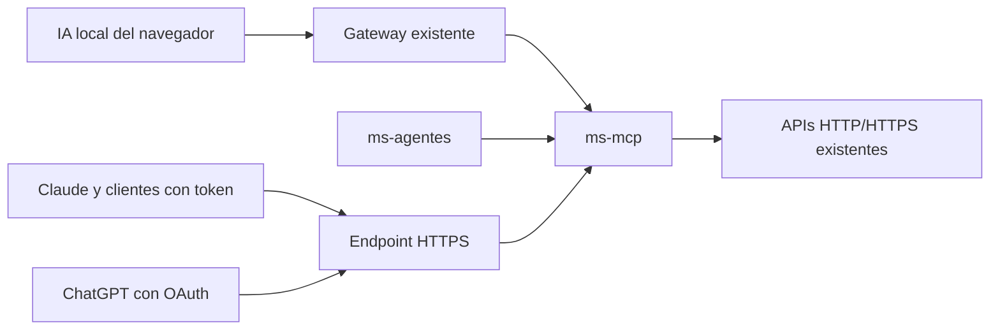

# ms-mcp con cambios mínimos y conexión sencilla para las IA

Estado: plan propuesto, pendiente de implementación. Este documento sustituye la propuesta anterior; no representa cambios ejecutados en los servicios.

## 1. Objetivo y límites

Crear `ms-mcp` para concentrar la consulta, combinación, filtrado y cálculo de reportes utilizando los datos que ya exponen los microservicios.

Decisiones confirmadas:

- Toda comunicación será por **HTTP en la red interna** y **HTTPS para conexiones externas**.
- MCP consultará las APIs REST y GraphQL existentes. GraphQL también se consume mediante HTTP/HTTPS.
- Los cálculos de reportes estarán en `ms-mcp`.
- En los otros servicios solo se modificarán lecturas, paginación o permisos cuando sea indispensable.
- No se crearán módulos de tienda, cobranza, clases o seguimiento de ejercicios dentro de esta entrega.
- Cuando falten datos, se indicará la limitación. No se inventarán registros ni se sustituirán por datos simulados.
- La IA local seguirá ejecutándose en el navegador.
- La primera versión ofrecerá consultas y exportaciones. No incluirá herramientas para cobrar, vender, modificar membresías ni ejecutar mantenimiento.

## 2. Conexión de las IA



### URL y token

Para clientes que admiten cabeceras de autenticación, la conexión tendrá dos elementos:

- URL: `https://<dominio>/mcp`
- Cabecera: `Authorization: Bearer <TOKEN>`

Se entregarán configuraciones listas para copiar según el cliente. La siguiente es una plantilla orientativa; el formato exacto depende de la aplicación:

```json
{
  "mcpServers": {
    "apex-fitness": {
      "url": "https://<dominio>/mcp",
      "headers": {
        "Authorization": "Bearer <TOKEN>"
      }
    }
  }
}
```

El JSON configura la conexión del **cliente MCP**. Después, el cliente descubre las herramientas y sus parámetros desde el servidor. No necesita cargar manualmente una descripción distinta para cada reporte.

| Consumidor | Configuración prevista |
|---|---|
| `ms-agentes` | URL interna y token exclusivo, configurados mediante variables de entorno |
| Clientes propios compatibles con MCP remoto | URL y token mediante su configuración |
| Claude | Conector remoto con URL y cabecera Bearer, usando sus opciones de cabeceras |
| ChatGPT | URL y autorización OAuth mediante inicio de sesión en Apex |
| WebLLM del proyecto | Usa la sesión existente y solicita las herramientas mediante el gateway; no recibe secretos |

Claude permite configurar credenciales fijas mediante cabeceras. ChatGPT no admite introducir una API key propia como sustituto de OAuth en esta conexión; allí la experiencia será **añadir URL → iniciar sesión → conectar**.

Referencias: [conectores remotos de Claude](https://support.claude.com/en/articles/11175166-get-started-with-custom-connectors-using-remote-mcp), [autenticación de MCP en ChatGPT](https://developers.openai.com/plugins/build/auth).

### Credenciales y permisos

- Emitir tokens independientes por consumidor, con propietario, permisos, vencimiento y revocación.
- Guardar únicamente sus huellas verificables en MCP y mostrar el secreto una sola vez.
- Separar permisos para asistencia, membresías, inventario, finanzas, entrenamiento, identidades y exportaciones.
- No utilizar un token maestro compartido entre todas las IA.
- Las llamadas del gateway conservarán la identidad del usuario mediante un contexto confiable generado en el servidor. El modelo no podrá elegir su identidad ni sus permisos.
- Para ChatGPT, reutilizar `ms-auth`: agregar únicamente el recurso, scopes y cliente OAuth necesarios, junto con URLs públicas coherentes.
- Mantener separados los tokens de acceso a MCP y las credenciales que MCP utiliza para consultar las APIs existentes.
- Verificar permisos en cada llamada y descarga, no solo durante el listado de herramientas.
- Un token externo no permitirá suplantar usuarios mediante cabeceras de identidad.

### WebLLM y gateway

Agregar al gateway:

- `GET /api/reportes/herramientas`: catálogo permitido para el usuario.
- `POST /api/reportes/consultas`: recibe `{ herramienta, argumentos }`, valida y ejecuta la llamada mediante el cliente MCP.
- Rutas de descarga autorizada para las exportaciones.

El navegador utiliza la sesión SSO existente. El gateway mantiene su credencial de MCP en el servidor y propaga el contexto del usuario por el canal autenticado.

WebLLM selecciona herramienta y argumentos mediante salida estructurada. El gateway no ejecuta texto libre del modelo como código. La interfaz muestra herramienta utilizada, periodo, datos consultados, estado de cobertura y resultado. El presupuesto inicial será de cinco llamadas por pregunta.

### Agente del backend

Crear un puerto de consultas de reportes y un adaptador cliente MCP en `ms-agentes`. Sustituir progresivamente las consultas equivalentes de `GymToolsAdapter`, conservando el comportamiento y las pruebas del motor de reglas.

El agente utilizará un token exclusivo con permisos mínimos. Podrá consultar mientras el navegador esté cerrado. Esto no incorpora nuevas acciones autónomas de escritura.

### ChatGPT y Claude

Registrar conexiones con el nombre **Apex Fitness Reportes**:

- **Claude:** introducir URL pública y credencial Bearer en las cabeceras del conector. Cada credencial tendrá un propietario y alcance; no compartir una credencial administrativa entre usuarios.
- **ChatGPT:** introducir URL pública, configurar OAuth y autorizar la cuenta del gimnasio. Utilizar un cliente OAuth prerregistrado; no habilitar registro dinámico abierto en esta entrega.

Los callbacks OAuth se registrarán exactamente como los indique la plataforma, sin comodines. Se comprobarán las funciones disponibles y los permisos de la cuenta o workspace durante la integración.

Las conexiones remotas de estas plataformas requieren que el servidor sea accesible desde su infraestructura. Una URL `localhost` o un nombre interno de Docker no sirve para la conexión remota de Claude o ChatGPT.

### Red y URLs

- Endpoint interno: `http://ms-mcp:8090/mcp`.
- Endpoint externo: `https://<dominio>/mcp`.
- Desarrollo: túnel HTTPS hacia el proxy que publique MCP y las rutas públicas necesarias para autorización.
- Producción: dominio estable, certificado TLS y proxy inverso; sin túnel temporal.
- El dominio será configuración de despliegue.
- No publicar nombres internos de Docker en metadatos de descubrimiento o redirecciones externas.
- El proxy respetará el transporte MCP, los tipos de respuesta JSON/SSE y las cabeceras requeridas por la revisión del protocolo utilizada.

## 3. Responsabilidades de ms-mcp y cambios permitidos

### Dentro de ms-mcp

Implementar:

- Servidor MCP con SDK oficial de Python y transporte Streamable HTTP.
- Catálogo de herramientas con parámetros tipados y respuestas estructuradas.
- Adaptadores para APIs existentes de gimnasio, inventario, entrenamiento e identidades.
- Recorrido de páginas, combinación de fuentes por identificadores y eliminación de duplicados de origen.
- Filtros temporales, agrupaciones, rankings, conteos y cálculos monetarios.
- Autenticación por token y validación OAuth.
- Auditoría de consultas y exportaciones CSV/PDF.
- Límites de consulta, timeouts y errores que distingan una fuente caída de una respuesta vacía.

Los clientes no podrán enviar SQL, documentos GraphQL arbitrarios ni URLs para que MCP los ejecute. Cada herramienta utilizará consultas predefinidas y argumentos validados. MCP no conectará directamente con las bases de datos de otros servicios.

### Cambios mínimos fuera de MCP

| Componente | Cambio permitido |
|---|---|
| `ms-gimnasio` | Corregir lecturas o paginación imprescindibles, especialmente la compatibilidad con DynamoDB y la propagación de errores |
| `ms-inventario` | Reutilizar las consultas existentes; agregar una lectura solo si un dato ya almacenado no resulta accesible |
| `ms-entrenamiento` | Reutilizar los contratos actuales; no incorporar ejecución de rutinas |
| `ms-auth` | Configuración OAuth indispensable para ChatGPT y protección de las consultas de identidad necesarias |
| `ms-agentes` | Adaptador cliente MCP para reemplazar progresivamente las consultas equivalentes |
| Gateway y shell | Acceso a herramientas desde la sesión existente y presentación de reportes |

No se trasladará lógica de reportes a los servicios de dominio ni se modificarán sus reglas de inscripción, pago, mantenimiento o entrenamiento.

Antes de cambiar un servicio se documentará el bloqueo concreto: campo almacenado inaccesible, lectura defectuosa, falta de paginación o permiso necesario. La solución deberá ser aditiva y conservar los contratos actuales.

### Contrato de resultados

Cada reporte entregará:

- Periodo interpretado, zona horaria y fecha de corte.
- Fuentes consultadas y cobertura disponible.
- Totales, filas y paginación.
- Definición de lo contado.
- Advertencias y limitaciones.
- Estado: `COMPLETO`, `PARCIAL`, `SIN_DATOS`, `NO_DISPONIBLE` o `NO_IMPLEMENTADO`.

Reglas:

- Zona predeterminada: `America/La_Paz`.
- Intervalos de inicio inclusivo y final exclusivo.
- Mes sin año: solicitar aclaración antes de consultar.
- “Último mes”: mes calendario anterior, mostrando la interpretación; ofrecer últimos treinta días cuando se solicite.
- Asistencia: entrada permitida. Separar visitas de socios únicos; salidas y accesos denegados no suman.
- Rachas: como máximo un día por socio y fecha local; por defecto, días calendario consecutivos.
- Inactividad: membresía vigente, última visita y tratamiento explícito de quienes nunca asistieron.
- Importes: decimal exacto y moneda explícita. No sumar monedas distintas sin una conversión registrada.
- Ingresos: cobros confirmados por fecha efectiva. Los pagos pendientes no representan recaudación.
- Una fuente caída no equivale a cero registros.
- El historial incompleto no permite afirmar que un total o ranking sea completo.
- La IA redacta las explicaciones; los cálculos se realizan en MCP y las cifras se validan frente al resultado estructurado.

## 4. Tratamiento de los veinte reportes

Se conserva el catálogo de diecisiete herramientas para cubrir las veinte preguntas, ajustando su capacidad a los datos existentes.

| # | Reporte solicitado | Herramienta | Tratamiento con este alcance |
|---|---|---|---|
| 1 | Clientes inscritos el último mes | `listar_inscripciones` | Consultar inscripciones y filtrar por fecha real de registro; distinguir nuevas inscripciones de renovaciones |
| 2 | Asistencias de clientes en octubre | `reporte_asistencias` | Año explícito, filtros temporales, paginación y separación entre visitas y socios únicos |
| 3 | Máquinas averiadas en agosto y mantenimiento previsto | `reporte_fallas_mantenimiento` | Consultar mantenimientos disponibles; si faltan eventos fechados de falla, no inferir la fecha de avería desde el estado actual ni desde la orden |
| 4 | Socios con más de 14 días sin venir | `listar_socios_inactivos` | Combinar membresía vigente y última entrada permitida; indicar el caso de quienes nunca asistieron |
| 5 | Socios con membresía por vencer en 7 días | `reporte_membresias_por_vencer` | Filtrar vigencia y vencimiento, con conteo deduplicado por socio |
| 6 | Recaudación de hoy por membresías y mostrador | `reporte_recaudacion` | Calcular cobros confirmados de membresías; resultado parcial si no existe una fuente de ventas de mostrador |
| 7 | Deuda total de socios morosos este mes | `reporte_morosidad` | Solo calcular si existen obligaciones, vencimientos y saldos; membresía vencida no demuestra deuda |
| 8 | Horas pico de asistencia de esta semana | `reporte_afluencia` | Agrupar entradas permitidas por hora local; no presentarlas como ocupación simultánea |
| 9 | Clases grupales llenas al 100% este mes | `reporte_ocupacion_clases` | Solo calcular con participación histórica por sesión y su capacidad; el cupo actual no acredita ocupación pasada |
| 10 | Instructor con más alumnos en clases grupales | `ranking_instructores` | Requiere relación real entre instructor, sesión y participación; no inferir alumnos a partir de cupos |
| 11 | Cinco suplementos o bebidas más vendidos | `ranking_productos_vendidos` | Declarar no implementado si no existen productos y ventas; no reinterpretar movimientos de máquinas como ventas |
| 12 | Productos de tienda con stock bajo | `listar_productos_stock_bajo` | Requiere productos, existencias y mínimos; inventario de máquinas no sustituye inventario de tienda |
| 13 | Diez clientes con mejor racha en tres meses | `ranking_rachas_asistencia` | Calcular sobre días locales con cobertura suficiente, criterio de racha y desempate explícitos |
| 14 | Clientes nuevos de baja o sin renovación en septiembre | `reporte_bajas_no_renovaciones` | Utilizar historial contractual disponible; aclarar año y cohorte, y señalar casos que no puedan determinarse |
| 15 | Socios con cuota impaga y más de 15 días de retraso | `reporte_morosidad` | Solo calcular con vencimiento y saldo verificables; comparación estricta de más de quince días |
| 16 | Socios que completaron su rutina esta semana | `reporte_cumplimiento_rutinas` | Declarar la limitación si solo existen rutinas asignadas y no registros de ejecución |
| 17 | Día del mes con menor afluencia | `reporte_afluencia` | Serie diaria completa, incluidos ceros comprobables; devolver empates y explicar tratamiento de días cerrados |
| 18 | Personas que ingresaron hoy entre 06:00 y 09:00 | `reporte_asistencias` | Intervalo local 06:00 inclusivo–09:00 exclusivo; separar visitas y personas únicas |
| 19 | Máquinas de cardio con más fallas este año | `ranking_fallas_equipos` | Requiere clasificación verificable y eventos de falla fechados; el estado actual no prueba frecuencia histórica |
| 20 | Comparación de ingresos de este mes y el anterior | `comparar_ingresos` | Comparar cobros confirmados y declarar fuentes faltantes; indicar si se comparan meses completos o avance equivalente |

Agregar `obtener_capacidades_reportes` para que las IA conozcan qué reportes pueden obtener y qué información falta.

La existencia de una herramienta no significará que tiene datos suficientes. Los resultados parciales no incluirán totales globales que aparenten estar completos.

### Exportaciones

- Generar CSV y PDF desde el mismo resultado normalizado.
- Exigir autorización tanto para generar como para descargar.
- Establecer vencimiento de archivos y limitar su tamaño.
- No publicar información de socios mediante enlaces permanentes anónimos.
- Proteger CSV contra fórmulas ejecutables.
- Identificar la generación de archivos como operación con efectos propios; no etiquetarla como una consulta sin efectos.
- Incluir fuentes, fecha de corte y limitaciones en la exportación.

## 5. Implementación y verificación

### Secuencia

1. **Inventariar las APIs:** documentar campos, autenticación, paginación y cobertura de cada fuente; identificar únicamente los bloqueos indispensables.
2. **Crear ms-mcp:** transporte, adaptadores HTTP, credenciales, catálogo y contrato de resultados.
3. **Implementar cálculos:** comenzar por inscripciones, accesos, vencimientos, inactividad y cobros de membresías.
4. **Integrar consumidores:** agente, gateway/WebLLM, configuración URL+token y conexión OAuth de ChatGPT.
5. **Publicar acceso HTTPS:** proxy y túnel para desarrollo; dominio estable y TLS para producción.
6. **Completar presentación y exportaciones:** tablas, fuentes, limitaciones y descargas autorizadas.

### Pruebas de aceptación

- Conectar un cliente compatible introduciendo solamente URL y token.
- Conectar Claude con Bearer y ChatGPT mediante OAuth.
- Descubrir herramientas y ejecutar consultas reales desde cada consumidor.
- Obtener resultados equivalentes para los mismos argumentos, permisos y corte.
- Verificar paginación con más de 500 registros, incluyendo el almacenamiento de accesos realmente configurado.
- Rechazar tokens revocados, vencidos o sin permisos.
- Impedir suplantación de identidad desde argumentos o cabeceras de un cliente externo.
- Distinguir cero resultados, fuente caída y datos históricos inexistentes.
- Validar fechas de Bolivia, límites de mes, reentradas y conteos deduplicados.
- Conciliar importes con los pagos de origen; rechazar totales mezclados de monedas.
- Comprobar que los cálculos residen en MCP y que los cambios externos se limitan a lecturas, compatibilidad y autenticación indispensables.
- Validar los veinte ejemplos: cada uno debe entregar un resultado comprobable o explicar precisamente qué información falta.
- Usar fixtures solo en pruebas aisladas; no cargar datos de demostración en las bases operativas para simular reportes completos.

### Entregables

- Servicio `ms-mcp`, Dockerfile y configuración de Compose.
- Catálogo y esquemas de herramientas.
- Adaptadores HTTP/HTTPS a las APIs actuales.
- Cliente MCP de agentes y conexión del gateway/WebLLM.
- Gestión de tokens con permisos y revocación.
- Configuraciones verificadas para clientes URL+token, Claude y ChatGPT.
- Reportes, exportaciones, pruebas y matriz de capacidades reales.
- Registro de los cambios mínimos realizados fuera de MCP y el bloqueo que resolvió cada uno.

Esta versión prioriza una conexión sencilla y aprovecha los datos actuales; no condiciona la incorporación de MCP a construir nuevos módulos de negocio.

## Referencias oficiales

- [SDK oficiales MCP](https://modelcontextprotocol.io/docs/sdk).
- [Streamable HTTP](https://modelcontextprotocol.io/specification/latest/basic/transports).
- [Herramientas MCP](https://modelcontextprotocol.io/specification/latest/server/tools).
- [Autorización MCP](https://modelcontextprotocol.io/specification/latest/basic/authorization).
- [Conexión personalizada en ChatGPT](https://developers.openai.com/api/docs/guides/custom-mcp-server).
- [Autenticación de MCP en ChatGPT](https://developers.openai.com/plugins/build/auth).
- [Conectores remotos de Claude](https://support.claude.com/en/articles/11175166-get-started-with-custom-connectors-using-remote-mcp).

Durante la implementación se fijarán versiones compatibles de SDK y protocolo y se comprobarán los formatos de configuración de los clientes elegidos. Los nombres de menús y las capacidades disponibles dependen de la versión y de los permisos de cada plataforma.
